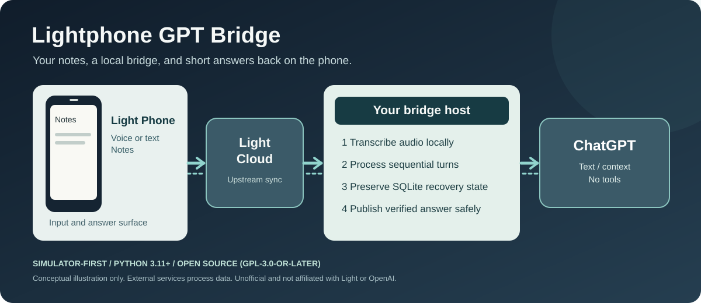

<div align="center">

# Lightphone GPT Bridge

### A quieter way to ask ChatGPT from a Light Phone.

**Voice or text Notes in. Short answers back. No smartphone interface required.**

[**How it works ↓**](#how-it-works) · [**Try the simulator →**](#quick-start) · [**Privacy boundaries →**](#privacy) · [**Installation →**](docs/installation.md)

<br>

[](https://github.com/jedufa/lightphone-gpt/actions/workflows/test.yml)
[](https://www.python.org/)
[](LICENSE)
[](#project-status)

</div>



<sub>Illustrative diagram, not a handset screenshot or a live deployment capture. Light Cloud and OpenAI remain external services.</sub>

Turn a Light Phone II note into a personal, asynchronous question-and-answer
loop. Voice is transcribed on the bridge host; accepted text is sent to
ChatGPT; the answer returns as a rolling `AI READY HH:MM` note.

## Project status

This is an **alpha, unofficial community project**. It is not affiliated with,
endorsed by, or supported by Light or OpenAI. Its Light Cloud integration uses
an unofficial client, so upstream changes can break it. Handset synchronization
is eventually consistent: an open answer note may need to be closed and
reopened before an update appears.

This source-only release contains the Python bridge and simulator. Private
deployment topology, operational evidence, user data, and the separately
reviewed phone-notifier client are outside its scope.

| Capability | Included | Evidence boundary |
|---|---:|---|
| Safe simulator and mock assistant | Yes | Covered by automated tests; no cloud access |
| Unofficial Light Cloud adapter | Yes | Mocked and bounded tests; upstream compatibility can change |
| Sign in with ChatGPT adapter | Yes | Uses an eligible account; cannot read ChatGPT chats or Memory |
| Local speech transcription | Optional | Ordinary transcription does not send audio to OpenAI |
| Real handset end-to-end validation | Not claimed | Must be verified by each operator on their own account and device |

## Quick start

Python 3.11 or newer is required. This path uses only the simulator and mock
assistant; it makes no Light Cloud or OpenAI request.

```bash
git clone https://github.com/jedufa/lightphone-gpt.git
cd lightphone-gpt
python3 -m venv .venv
. .venv/bin/activate
python -m pip install -e '.[dev]'

export LIGHTPHONE_GPT_STATE_DIR="$PWD/runtime"
lightphone-gpt init
lightphone-gpt simulator seed-text \
  --title 'Example' \
  --content 'Assistant, give me one calm sentence.'
lightphone-gpt cycle
lightphone-gpt status
```

A successful cycle reports one published simulated job. Read
[Installation](docs/installation.md) before configuring real providers. For an
exact dependency graph, install [uv](https://docs.astral.sh/uv/) and run
`uv sync --frozen --extra dev`.

## How it works

The worker polls Notes, identifies each note by its Light note ID, and handles
one conversational turn at a time. It stores the transcript before inference
and the completed answer before publication. It does not regenerate an answer
just because publishing failed.

Supported interactions are:

- `Assistant, <question>` for a new question or contextual follow-up.
- `Assistant, continue` for the next stored section of a long answer.
- `Assistant, new conversation` to start with empty conversation context.
- `Assistant, reset` to abandon a safely recoverable stalled turn, clear older
  pending conversation work, and start a new conversation without a model call.

Text notes must begin with `Assistant`. Audio routing also tolerates a small
set of observed speech-recognition variants. Titles and filenames do not grant
ownership and are never used as request identity.

## Capabilities and limits

- Voice recordings are transcribed on the bridge host with faster-whisper or
  whisper.cpp; ordinary audio is not sent to OpenAI for prefix detection.
- Accepted text and local conversation context are sent to ChatGPT. Model
  requests use streaming, `store=false`, and no tools.
- SQLite provides a sequential queue, deduplication, retry state, conversation
  context, retention metadata, and guarded publication recovery.
- New recognized requests can supersede an uncertain publication so later work
  continues on a fresh answer surface without repeating the old Light mutation
  or model call. `reset` also covers a bounded set of local recovery stalls; it
  does not bypass account, authorization, configuration, or usage gates.
- A fresh real database baselines existing Notes instead of processing old
  content.
- Automatic source-note deletion is opt-in and occurs only after the answer is
  durably verified. Light does not expose a conditional delete operation, so a
  narrow edit/delete race remains for text notes.
- Synchronization timing and phone-side refresh behavior are controlled by
  Light Cloud and are not guaranteed by this project.
- The bridge cannot access existing ChatGPT conversations or ChatGPT Memory.
- ChatGPT subscription access and separately billed OpenAI API access are
  different products. This code implements Sign in with ChatGPT; it does not
  implement API-key authentication.

## Privacy

The data path can involve the phone, Light Cloud, the bridge host, and OpenAI.
Questions, transcripts, answers, and local conversation context may contain
personal data. Configure retention deliberately and protect the SQLite state,
model cache, Light credentials, and ChatGPT tokens as secrets. Do not place any
of them in Git, container images, CI variables exposed to pull requests, or
support logs.

The default checkout uses only simulated providers. Real access requires
explicit adapter choices plus a production activation sentinel. See
[Security and privacy](docs/security.md) for trust boundaries and
[Installation](docs/installation.md) for the activation checklist.

## Testing

```bash
uv sync --frozen --extra dev --extra chatgpt
uv run --frozen pytest
uv run --frozen python -m compileall -q src tests
uv run --frozen python tools/build_release.py
git diff --check
```

Tests use injected adapters and synthetic fixtures. They must not require real
Light credentials, ChatGPT credentials, paid inference, or network access.
The release builder exports the committed tree, uses its commit time as
`SOURCE_DATE_EPOCH`, and normalizes archive metadata so two builds of the same
commit produce byte-identical wheel and source archives.

## Maintenance and troubleshooting

- Start with `lightphone-gpt status`; it reports content-free state counts and
  active recovery gates.
- Treat an uncertain Light create/update or an interrupted model call as an
  ambiguous outcome. Do not blindly repeat it. A later recognized request can
  continue on a fresh answer surface; use `Assistant, reset` when the old
  conversational backlog should also be discarded.
- If a note is visible in Light Cloud but stale on the handset, close and reopen
  it before concluding publication failed.
- Re-run the simulator suite after updating the pinned unofficial Light client.

The recovery model and trust boundaries are described in
[Architecture](docs/architecture.md). Please use a private GitHub security
advisory for suspected vulnerabilities; see [SECURITY.md](SECURITY.md).

## Acknowledgments and license

The optional Light Cloud adapter depends on
[Alexis Garado's `garado/light`](https://github.com/garado/light), an unofficial
Light device API distributed under GPL-3.0-or-later with an attribution term.
Other dependency notices are in [THIRD_PARTY_NOTICES.md](THIRD_PARTY_NOTICES.md).

The bridge is distributed under GPL-3.0-or-later. See [LICENSE](LICENSE).
Light, Light Phone, ChatGPT, and OpenAI are trademarks of their respective
owners.
